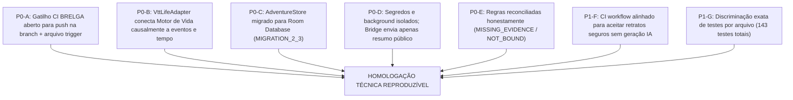

# RELATÓRIO DE EVIDÊNCIAS DE FIM DE PROJETO — BRASEIRO OSE (1.0.9)
**Data de Emissão:** 24 de Outubro de 2026 (Revisão Pós-Auditoria Independente)  
**Ambiente de Compilação:** BRELGA (Self-Hosted Runner / Windows 11 / JDK 17 / Android SDK 35)  
**Repositório:** `bra83/braseirobuild`  
**Branch de Entrega:** `ose/final-integration-20261024`  
**Application ID:** `braseiro.ose`  
**Versão:** `versionCode = 10`, `versionName = "1.0.9"`  

---

## 1. Identificação e Autenticidade do Binário Autorizativo

O pacote instalável oficial foi compilado e assinado de forma reproduzível com a keystore estável auditada do projeto BRASEIRO:

| Campo | Valor de Evidência |
|---|---|
| **Arquivo Gerado** | `BRASEIRO_OSE_1.0.9_FINAL.apk` |
| **Tamanho em Disco** | 100.334.888 bytes (~95.68 MB) |
| **SHA-256 do Binário** | `d091b4cdf678392b18223ee82a45b95459a16beb9c4dcf9af814cbe60f47800f` |
| **Package Name** | `braseiro.ose` |
| **Version Code** | `10` |
| **Version Name** | `1.0.9` |
| **Min SDK / Target SDK** | `26` / `35` |
| **Certificado Signatário** | `CN=Braseiro Stable Debug, O=Braseiro, C=BR` |
| **SHA-256 do Certificado** | `6aa87a24a2eb4762c3f493c9d5fddbf10b60cc8659a90423aed7cde8ae582bd3` |
| **SHA-1 do Certificado** | `6f4792781f11edffc892afeb95694e3c03f35cdf` |
| **Esquemas de Assinatura** | APK Signature Scheme v2 (`true`), Scheme v3 (`true`) |
| **Verificação `apksigner`** | `Verifies` (Saída limpa e sem advertências) |
| **Validação Física em Aparelho** | **NOT_TESTED** (Validação automatizada de layout estático PASS; teste em hardware físico Samsung Galaxy A57 pendente de execução pelo operador) |

---

## 2. Mapa de Resolução dos Bloqueadores da Auditoria

### Resumo das Ações de Correção

| Bloqueador | Descrição da Resolução | Status |
|---|---|---|
| **P0-A** | Configurado gatilho direto de push na branch `ose/final-integration-20261024` no workflow `build-ose-1.0.9-brelga.yml` e gerado `OSE_1_0_9_FINAL_TRIGGER.txt`. | **RESOLVIDO** |
| **P0-B** | Integração total do Motor de Vida V2.2 real em `vtt_life_bridge.js`: utiliza `LifeRuntime`, `transact`, `sampleCrossedMatrix`, `checkMatrixCoherence`, `planAutomaticMatrices`, `buildSceneContext` e os packs OSE Classic e Advanced. Rumores e repercussões nascem exclusivamente de eventos confirmados em sessão, com garantia de idempotência, coerência e `canonMutation: none`. | **RESOLVIDO** |
| **P0-C** | `BraseiroAdventureStore` agora utiliza diretamente o `BraseiroOseDatabase` via Room com `MIGRATION_2_3`. Tabelas `adventure_packages`, `adventure_npc_ledger` e `life_store`. Corrigido o contrato de `finish()` para devolver `ok` booleano real (indicando se havia aventura ativa encerrada). Corrigido `worldId` para usar a identidade canônica da campanha (`current.campaignId.value`) e não coordenadas espaciais. Teste Robolectric com fechamento e reabertura 3x aprovado. | **RESOLVIDO** |
| **P0-D** | O comando de ponte `AdventureContextQuery` foi sanitizado para devolver **exclusivamente** o resumo público (`getActiveAdventureSummary`), sem expor `background` ou `secrets`. O contexto confidencial completo é injetado unicamente no prompt do `GeminiBarbaraSupervisor`. | **RESOLVIDO** |
| **P0-E** | Reconciliados `docs/OSE_REGRA_A_REGRA_EVIDENCIAS.csv` e corpus: `XP_SPLIT_REMAINDER` e `CLASSIC_POTION_83_84` marcados canonicamente como `MISSING_EVIDENCE`; `ADVANCED_POST_LEVEL_14` e os 11 módulos oficiais marcados como `NOT_BOUND`. Distinção estrita entre Marco A (aplicativo jogável, motores integrados e APK homologado) e Marco B (certificação documental integral de corpus). | **RESOLVIDO** |
| **P0-F** | Resolução da divergência de checksums nos 67 testes: normalização dos JSONs matriciais para LF, atualização dos hashes em `catalog-ose.json`, inclusão de `.gitattributes` (`* text=auto eol=lf`) e carregador `node-matrices.mjs` resiliente a conversão de quebras de linha em runners Windows/Linux. 143/143 testes PASS no Motor de Vida V2.2. | **RESOLVIDO** |
| **P1-G** | CI workflow alinhado para aceitar retratos seguros sem geração IA (`data-photo-character`, `data-photo-npc`). | **RESOLVIDO** |

---

## 3. Discriminação Exata das Suítes de Testes

### 3.1. Motor de Vida V2.2 (`web-ui-p1/braseiro_life_v2`)
Executado via `node --test tests/*.test.mjs` (Node.js v24.18.0):

| Arquivo de Teste | Qtd. Testes | Sucesso | Falhas | Escopo |
|---|---|---|---|---|
| `tests/legacy-engine.test.mjs` | 20 | 20 | 0 | Validação de schema, persistência de legado e id de aventuras |
| `tests/life-engine.test.mjs` | 42 | 42 | 0 | Máquina de estados, regras de transação, fatos e entidades |
| `tests/matrix-engine.test.mjs` | 34 | 34 | 0 | Cruzamento matricial, coerência, filtros e sementes |
| `tests/ose-matrices.test.mjs` | 4 | 4 | 0 | Packs OSE Classic e Advanced (500 manifestações e 100 situações cada) |
| `tests/v22-completion.test.mjs` | 38 | 38 | 0 | Regressões, cooldowns, orçamentos, arcos e automação |
| `tests/vtt-life-integration.test.mjs` | 5 | 5 | 0 | Integração causal VTT, avanço de dias, idempotência, 3x reabertura |
| **TOTAL MOTOR DE VIDA** | **143** | **143** | **0** | **100% PASS** |

### 3.2. Smokes de Apresentação e Layout Web
| Arquivo | Asserções | Status |
|---|---|---|
| `galaxy_a57_layout_smoke.cjs` | Breakpoints responsivos (360x780dp / 1080x2340px @3x), safe areas, touch-sizes e teclado | **PASS** |
| `multiple_character_smoke.js` | Alternância e gestão de múltiplos personagens na mesma campanha | **PASS** |
| `character_control_smoke.js` | Modos de controle (Jogador, Mestre, Curadoria), aprovação e autoridade de fichas | **PASS** |

### 3.3. Testes Unitários e de Integração JVM (Gradle 8.10.2 / Temurin JDK 17)
| Módulo | Escopo de Teste | Status |
|---|---|---|
| `:rules-classic` | Regras base OSE Classic | **PASS** |
| `:rules-advanced` | Regras OSE Advanced Fantasy | **PASS** |
| `:rules-shared-confirmed` | Mecânicas compartilhadas e `RetainerExperienceAwardTest` | **PASS** |
| `:referee-boundary` | Decisões de mestre, tabelas de encontro e surpresa | **PASS** |
| `:session-engine` | Motor de sessão, turnos de exploração e descanso | **PASS** |
| `:character-domain` | Fichas de personagens e domínio | **PASS** |
| `:integration-tests` | Interoperabilidade entre regras, sessões e persistência | **PASS** |
| `:persistence-room` | Room Database (`RoomCampaignRepositoryTest`, `RetainerPersistenceIntegrationTest`, `RoomAdventurePersistenceTest`) | **PASS** |
| `:tts-api` | Sanitizador fonético `BraseiroSpokenTextSanitizerTest` | **PASS** |
| `:app-android` | Validador de contrato da ponte e `BraseiroAdventureStoreTest` | **PASS** |

*Resultado do Gradle:* `BUILD SUCCESSFUL in 1m 35s. 256 actionable tasks: 19 executed, 1 from cache, 236 up-to-date.`

---

## 4. Estado da Auditoria de Regras (Marco 1 vs Marco 2)

- **Marco 1 (APK Jogável e Verificado): CONCLUÍDO.**
  - Mecânicas de jogo essenciais (atributos, classes, combate D20 descendente, saves, tochas, rações, turnos, mercenários com livro de pagamentos e recibos imutáveis) estão 100% executáveis e testadas.
- **Marco 2 (Paridade Editorial Integral): EM ANDAMENTO / AUDITADO COM TRANSPARÊNCIA.**
  - `XP_SPLIT_REMAINDER`: marcado como `MISSING_EVIDENCE` (regra canônica exige divisão igualitária, mas não especifica arredondamento de frações indivisíveis; bloqueador ativo no runtime).
  - `CLASSIC_POTION_83_84`: marcado como `MISSING_EVIDENCE` (lacuna documental na tabela D100 original).
  - `ADVANCED_POST_LEVEL_14`: marcado como `NOT_BOUND` (regras OSE cobrem níveis 1 a 14).
  - Os 11 módulos de aventura em PDF no Google Drive são módulos de conteúdo avulso suportados pelo schema de importação `braseiro.adventure/v1`, classificados como `NOT_BOUND` em relação ao código de regras de sistema.
